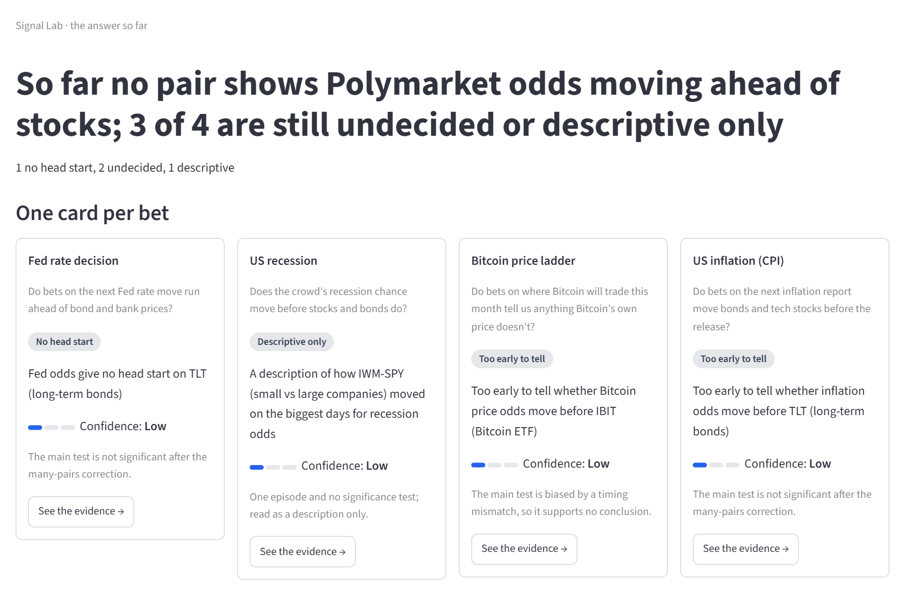
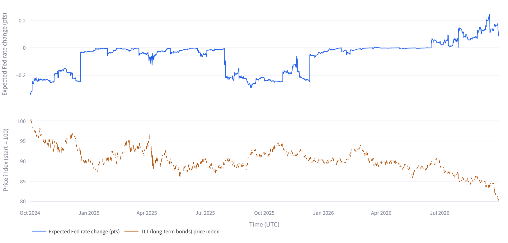
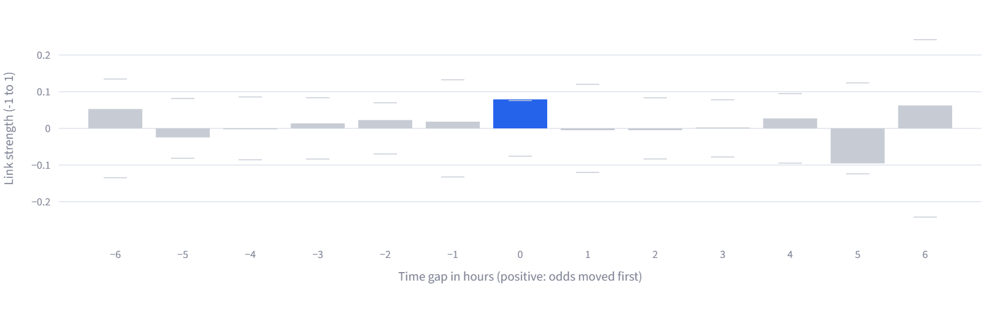
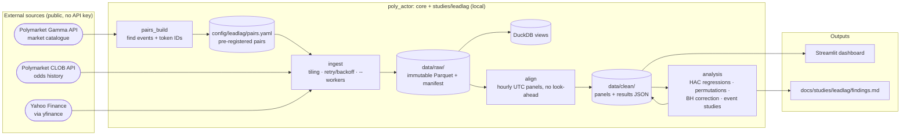
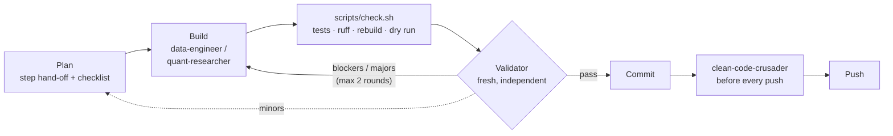
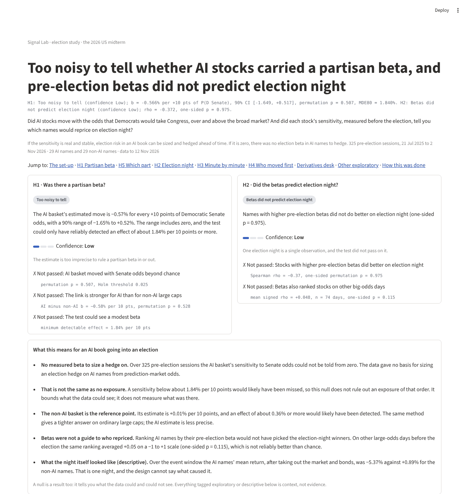

# poly_actor

_Do the betting crowd's odds move before the market does?_

An **agentic research lab**: AI agents with fixed roles (data engineer, quant researcher,
independent validator, code reviewer) build and check end-to-end studies of how
**prediction-market odds and stocks move together**. Each study covers data engineering (API
ingestion, immutable raw store, look-ahead-safe alignment), pre-registered analysis, and
investment research output (a Streamlit page and a generated findings report).

| Study | Question | Answer |
|---|---|---|
| [`leadlag`](docs/studies/leadlag/README.md) | Do Polymarket odds lead, lag, or move with related stocks? | [findings](docs/studies/leadlag/findings.md) |
| [`election`](docs/studies/election/README.md) | Did AI stocks carry a partisan beta around the 2026 US midterm? | [findings](docs/studies/election/findings.md) |

Studies share one toolkit (`src/poly_actor/core/`) and never depend on each other, so a new study
starts from working data clients, time alignment and statistics. See
[how to add a study](docs/studies/README.md). `python -m poly_actor` lists the studies.

[](docs/studies/leadlag/images/dashboard-answer.png)

| Polymarket odds vs the stock, side by side | Which moved first? (correlation by time gap) |
|---|---|
| [](docs/studies/leadlag/images/fed-odds-vs-tlt.png) | [](docs/studies/leadlag/images/fed-lead-lag.png) |

_Screenshots from the lead-lag study's Streamlit dashboard. The live verdicts and
numbers are in [`docs/studies/leadlag/findings.md`](docs/studies/leadlag/findings.md), which is generated from the results._

> **Disclaimer.** A personal research project, **not financial advice**. The code is **paper
> only**: it never places orders or moves money. Data comes from public third-party sources and may
> be incomplete, delayed, or wrong.

## Study 1 (`leadlag`): the question, as four bets

| Polymarket bet | Compared with | Test |
|---|---|---|
| Fed rate decision | TLT (long-term bonds) | hourly lead-lag regression |
| Bitcoin monthly price ladder | IBIT (Bitcoin ETF), BTC-USD as control | hourly lead-lag regression |
| US inflation (CPI) | TLT, tech stocks | release-day event study |
| US recession | IWM minus SPY (small vs large caps) | descriptive event study |

Every pair has a written rationale in [`config/leadlag/pairs.yaml`](config/leadlag/pairs.yaml), and every test was
fixed in [`docs/studies/leadlag/preregistration.md`](docs/studies/leadlag/preregistration.md) before results were seen.

### Architecture



- **One-way data flow.** Raw downloads are never edited; everything after them is rebuildable
  with one command (`python -m poly_actor.studies.leadlag.refresh`).
- **Point-in-time correct.** A value at time *t* only uses data available at or before *t*.
  Timestamps are tz-aware UTC throughout.
- **Single source of truth.** The dashboard and `findings.md` read the same results files and share
  the headline code, so they cannot disagree.

## The agentic workflow that builds every study



Agent definitions live in [`.claude/agents/`](.claude/agents/). Each study keeps its step
hand-offs and every validator and reviewer report in `docs/studies/<study>/handoff/` and
`reviews/`. A `tutor` agent writes short lessons in `notebooks/` after a step.

## Data connections (shared clients in `core/ingest`)

| Source | How it connects | Used for | Handled quirks |
|---|---|---|---|
| **Polymarket CLOB**<br/>`clob.polymarket.com/prices-history` | `requests` GET, no auth. Params: Yes-token ID, `startTs`, `endTs`, `fidelity` (60 / 10 / 1 min) | Odds history (Yes price = probability) | 15-day window cap (tiled); API appends the live price after `endTs` (clipped, a look-ahead trap); inconsistent start boundary (padded + de-duplicated); hourly gaps backfilled at 10-min fidelity |
| **Polymarket Gamma**<br/>`gamma-api.polymarket.com` | `requests` GET `/events`, paginated 100 per page | Finding the markets and their token IDs for `pairs.yaml` | Offline by default (local cache, error on a miss); network only with `--refetch`; 0.5 s pause and a 120-call budget |
| **Yahoo Finance**<br/>via [`yfinance`](https://github.com/ranaroussi/yfinance) | `Ticker.history(interval="1h", auto_adjust=False)` | Hourly stock, ETF and BTC-USD bars | 730-day limit for hourly data (180-day chunks); silent empty results treated as failures; unadjusted prices; only fully settled days stored |

All HTTP calls share one helper (`core/ingest/common.py`) that retries 429, 5xx and timeouts with
exponential backoff and honours `Retry-After`. Each call is logged with its SHA-256 in a
`_manifest.jsonl` next to the Parquet files. FOMC and CPI dates are typed in from the official Fed
and BLS calendars, not fetched. Tests never touch the network; they use saved responses in
`tests/<study>/fixtures/`.

## Status

Both studies are done, validated and pushed. Progress and decisions are in
[`docs/progress.md`](docs/progress.md); open minors and ideas are in
[`docs/backlog.md`](docs/backlog.md).

| Study | Steps | What |
|---|---|---|
| `leadlag` | 0–2 | Setup and agent harness, data feasibility check, pre-registered pairs |
| | 3–4 | Ingestion; alignment into hourly panels (no look-ahead, market hours only) |
| | 5–7 | Dashboard, pre-registered analysis, generated findings and one-command refresh |
| `election` | 8–10 | Data pipeline, pre-registered analysis, presentation and generated findings |

## Study 2 (`election`): the partisan beta of AI

A self-contained study on the 2026 US midterm: did AI stocks carry a sensitivity to the
odds that Democrats take Congress, over and above the broad market, and did that sensitivity,
measured before the election, say which names would reprice on election night? The plan is frozen
in [`docs/studies/election/preregistration.md`](docs/studies/election/preregistration.md). The answer, its limits
and every number are in the generated [`docs/studies/election/findings.md`](docs/studies/election/findings.md) and
in a Streamlit presentation written for people who trade AI equities and derivatives.

[](docs/studies/election/images/01-answer.png)

```bash
.venv/bin/streamlit run src/poly_actor/studies/election/app.py   # the presentation (reads reports/election/)
.venv/bin/python -m poly_actor.studies.election report           # reports/election/ -> docs/studies/election/findings.md
```

The published results bundle in `reports/election/` is tracked, so both commands work on a fresh
clone with no data pull. To rebuild it from scratch: `python -m poly_actor.studies.election ingest`, then
`panel`, `analyse` and `publish`. On Windows use `.venv/Scripts/streamlit.exe` and
`.venv/Scripts/python.exe`. More screenshots are in [`docs/studies/election/images/`](docs/studies/election/images/).

## Setup

Requires Python 3.11+. No API keys are needed.

```bash
python -m venv .venv
.venv/Scripts/python.exe -m pip install -e ".[dev]"   # Windows; use .venv/bin/python on macOS/Linux
```

## Run the lead-lag study

```bash
.venv/Scripts/python.exe -m poly_actor.studies.leadlag.refresh --workers 4      # ingest -> align -> analysis -> report
.venv/Scripts/python.exe -m poly_actor.studies.leadlag.refresh --dry-run        # print the stages; run nothing
.venv/Scripts/streamlit.exe run src/poly_actor/studies/leadlag/dashboard/app.py # http://localhost:8501
```

The refresh stops at the first stage that fails and names it. The stages can also be run one at a
time:

```bash
.venv/Scripts/python.exe -m poly_actor.studies.leadlag.ingest run --workers 4    # fetch raw data into data/raw/
.venv/Scripts/python.exe -m poly_actor.studies.leadlag.align run                 # build hourly panels in data/clean/
.venv/Scripts/python.exe -m poly_actor.studies.leadlag.analysis run --workers 4  # tests -> data/clean/results/*.json
.venv/Scripts/python.exe -m poly_actor.studies.leadlag.analysis report           # results -> docs/studies/leadlag/findings.md
```

Restart Streamlit after a refresh if it was already running.

## Tests and lint

```bash
.venv/Scripts/python.exe -m pytest              # offline; network access is blocked in tests
.venv/Scripts/python.exe -m pytest -m live      # tests that call the real APIs
.venv/Scripts/ruff.exe check . && .venv/Scripts/ruff.exe format --check .
```

## Layout

```
src/poly_actor/
  core/             shared toolkit: ingest/ timegrid/ stats/ store/ ui/ io.py timeutil.py
  studies/
    leadlag/        ingest/ pairs_build/ align/ analysis/ dashboard/ refresh.py pairs.py
    election/       ingest, panel, analysis, bundle, findings, charts, app
config/<study>/     pre-registered pairs, signals and universes, each with a rationale
docs/
  studies/<study>/  preregistration, findings (generated), handoff/, reviews/, images
  studies/_template/  starting point for a new study
  lessons.md progress.md backlog.md harness/
reports/<study>/    tracked results bundle (election)
tests/<study>/      offline tests, synthetic-data helpers and fixtures/ (saved API responses); tests/core/
scripts/            check.sh, build_pairs.py
notebooks/          exploration and short lessons
.claude/            agents, hooks and skills used to build this repo with Claude Code
```

`tests/core/test_architecture.py` keeps the layout honest: `core` never imports a study, a study
never imports another study, and every study is registered with its standard places.

## Data terms

This repo does not redistribute data. You download it yourself and are responsible for following
each provider's terms of use. `yfinance` is unofficial and not affiliated with Yahoo.

## License

[MIT](LICENSE)
