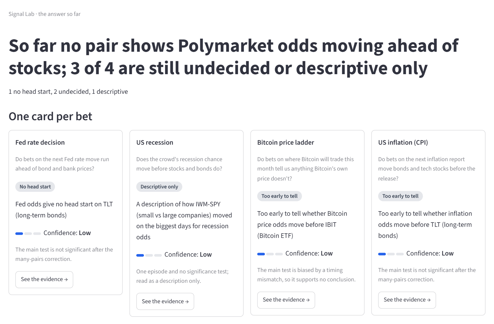
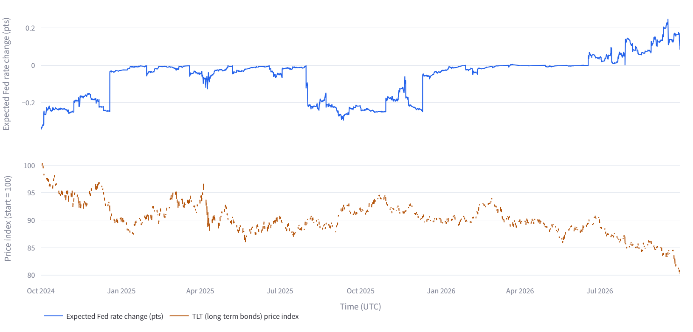
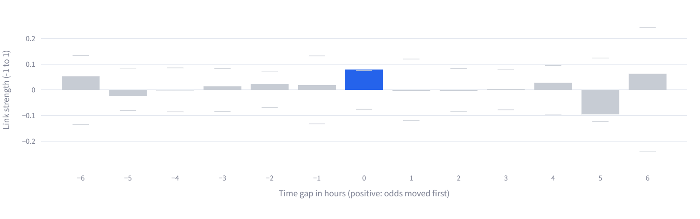
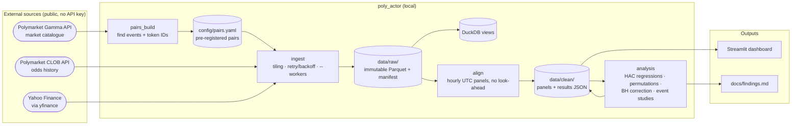
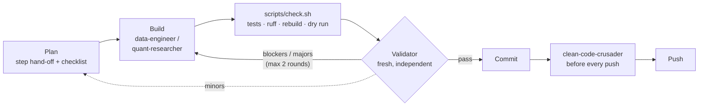

# poly_actor

_Do the betting crowd's odds move before the market does?_

An **agentic research pipeline**: AI agents with fixed roles (data engineer, quant researcher,
independent validator, code reviewer) build and check an end-to-end study of whether
**Polymarket prediction-market odds lead, lag, or move with related stocks**. It covers
data engineering (API ingestion, immutable raw store, look-ahead-safe alignment), data analysis
(pre-registered lead-lag tests) and investment research (a lay-reader dashboard and a generated
findings report).

[](docs/images/dashboard-answer.png)

| Polymarket odds vs the stock, side by side | Which moved first? (correlation by time gap) |
|---|---|
| [](docs/images/fed-odds-vs-tlt.png) | [](docs/images/fed-lead-lag.png) |

_Screenshots from the local Streamlit dashboard at the end of milestone 1. The live verdicts and
numbers are in [`docs/findings.md`](docs/findings.md), which is generated from the results._

> **Disclaimer.** A personal research project, **not financial advice**. The code is **paper
> only**: it never places orders or moves money. Data comes from public third-party sources and may
> be incomplete, delayed, or wrong.

## The question, as four bets

| Polymarket bet | Compared with | Test |
|---|---|---|
| Fed rate decision | TLT (long-term bonds) | hourly lead-lag regression |
| Bitcoin monthly price ladder | IBIT (Bitcoin ETF), BTC-USD as control | hourly lead-lag regression |
| US inflation (CPI) | TLT, tech stocks | release-day event study |
| US recession | IWM minus SPY (small vs large caps) | descriptive event study |

Every pair has a written rationale in [`config/pairs.yaml`](config/pairs.yaml), and every test was
fixed in [`docs/preregistration.md`](docs/preregistration.md) before results were seen.

## SAD



- **One-way data flow.** Raw downloads are never edited; everything after them is rebuildable
  with one command (`python -m poly_actor.refresh`).
- **Point-in-time correct.** A value at time *t* only uses data available at or before *t*.
  Timestamps are tz-aware UTC throughout.
- **Single source of truth.** The dashboard and `findings.md` read the same results files and share
  the headline code, so they cannot disagree.

### The agentic workflow that built it



Agent definitions live in [`.claude/agents/`](.claude/agents/), step hand-offs in
[`docs/handoff/`](docs/handoff/) and every validator and reviewer report in
[`docs/reviews/`](docs/reviews/). A `tutor` agent writes short lessons in `notebooks/` after a step.

## Data connections

| Source | How it connects | Used for | Handled quirks |
|---|---|---|---|
| **Polymarket CLOB**<br/>`clob.polymarket.com/prices-history` | `requests` GET, no auth. Params: Yes-token ID, `startTs`, `endTs`, `fidelity` (60 / 10 / 1 min) | Odds history (Yes price = probability) | 15-day window cap (tiled); API appends the live price after `endTs` (clipped, a look-ahead trap); inconsistent start boundary (padded + de-duplicated); hourly gaps backfilled at 10-min fidelity |
| **Polymarket Gamma**<br/>`gamma-api.polymarket.com` | `requests` GET `/events`, paginated 100 per page | Finding the markets and their token IDs for `pairs.yaml` | Offline by default (local cache, error on a miss); network only with `--refetch`; 0.5 s pause and a 120-call budget |
| **Yahoo Finance**<br/>via [`yfinance`](https://github.com/ranaroussi/yfinance) | `Ticker.history(interval="1h", auto_adjust=False)` | Hourly stock, ETF and BTC-USD bars | 730-day limit for hourly data (180-day chunks); silent empty results treated as failures; unadjusted prices; only fully settled days stored |

All HTTP calls share one helper (`ingest/common.py`) that retries 429, 5xx and timeouts with
exponential backoff and honours `Retry-After`. Each call is logged with its SHA-256 in a
`_manifest.jsonl` next to the Parquet files. FOMC and CPI dates are typed in from the official Fed
and BLS calendars, not fetched. Tests never touch the network; they use saved responses in
`tests/fixtures/`.

## Status

**Milestone 1 is done** (2026-10-08): steps 0–7 built, validated and pushed. Progress and decisions
are in [`docs/progress.md`](docs/progress.md), and ideas for milestone 2 are in
[`docs/handoff/milestone2_backlog.md`](docs/handoff/milestone2_backlog.md).

| Step | What |
|---|---|
| 0–2 | Setup and agent harness, data feasibility check, pre-registered pairs |
| 3 | Ingestion of Polymarket and stock price history |
| 4 | Alignment into hourly panels (no look-ahead, market hours only) |
| 5 | Dashboard for a lay reader |
| 6 | Pre-registered statistical analysis |
| 7 | Generated findings report, one-command refresh |

## Setup

Requires Python 3.11+. No API keys are needed.

```bash
python -m venv .venv
.venv/Scripts/python.exe -m pip install -e ".[dev]"   # Windows; use .venv/bin/python on macOS/Linux
```

## Run

```bash
.venv/Scripts/python.exe -m poly_actor.refresh --workers 4      # ingest -> align -> analysis -> report
.venv/Scripts/python.exe -m poly_actor.refresh --dry-run        # print the stages; run nothing
.venv/Scripts/streamlit.exe run src/poly_actor/dashboard/app.py # http://localhost:8501
```

The refresh stops at the first stage that fails and names it. The stages can also be run one at a
time:

```bash
.venv/Scripts/python.exe -m poly_actor.ingest run --workers 4    # fetch raw data into data/raw/
.venv/Scripts/python.exe -m poly_actor.align run                 # build hourly panels in data/clean/
.venv/Scripts/python.exe -m poly_actor.analysis run --workers 4  # tests -> data/clean/results/*.json
.venv/Scripts/python.exe -m poly_actor.analysis report           # results -> docs/findings.md
```

Restart Streamlit after a refresh if it was already running.

## Tests and lint

```bash
.venv/Scripts/python.exe -m pytest              # offline; network access is blocked in tests
.venv/Scripts/python.exe -m pytest -m live      # tests that call the real APIs
.venv/Scripts/ruff.exe check . && .venv/Scripts/ruff.exe format --check .
```

## Layout

```
src/poly_actor/   ingest/ pairs_build/ store/ align/ analysis/ dashboard/ refresh
config/           pairs.yaml (pre-registered pairs)
docs/             plan, pre-registration, findings, progress, hand-offs, reviews, images
notebooks/        exploration and short lessons
scripts/          check.sh, build_pairs.py
tests/            offline tests and saved API responses
.claude/          agents, hooks and skills used to build this repo with Claude Code
```

## Data terms

This repo does not redistribute data. You download it yourself and are responsible for following
each provider's terms of use. `yfinance` is unofficial and not affiliated with Yahoo.

## License

[MIT](LICENSE)
